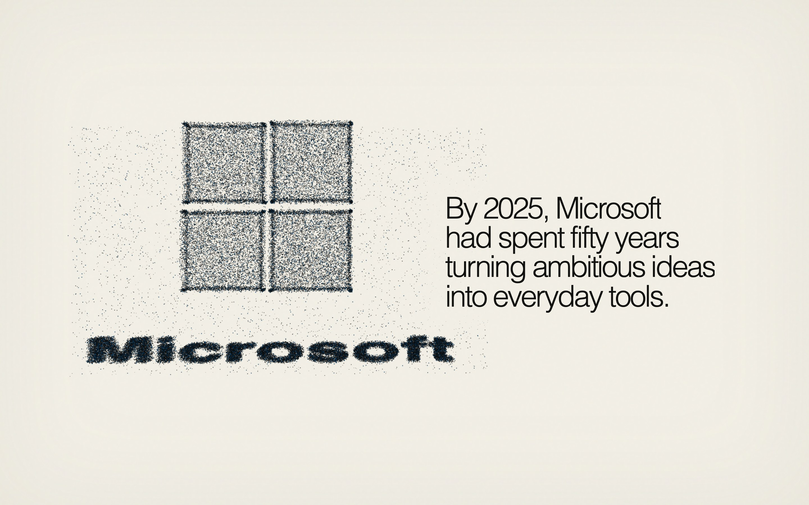

# Microsoft: 50 Years of Computing



An original scroll-driven WebGL essay marking Microsoft's first fifty years.
One persistent field of particles reorganizes from the first BASIC source
listing through PCs, Windows and the Internet, connected enterprise workflows,
cloud datacenters, agent fleets, the Microsoft mark, and a rocket lifting
toward an AI-enabled age of abundance.

**This is an unofficial personal tribute. It is not sponsored or endorsed by
Microsoft.**

## Experience

- Warm paper-like canvas with near-black, depth-aware particles.
- Eight semantic historical eras with one continuously evolving WebGL system.
- One light, sans-serif editorial sentence per era with a monochrome
  scroll-driven word reveal.
- GPU-side morphing between original procedural targets.
- Subtle pointer yaw/pitch that reveals real Z depth at any scroll position.
- Restrained time-based idle movement after scrolling stops.
- Desktop, tablet, mobile, and reduced-motion quality tiers.
- No backend, database, runtime API, remote model, texture, image, video, or
  font dependency.

The complete generated visual review is in
[`site/screenshots/`](site/screenshots/), including rocket-on-pad, liftoff, and
ascent states.

## Architecture

```text
semantic HTML timeline
├── sticky copy rail
└── decorative WebGL2 canvas
    └── Three.js scene
        ├── perspective camera
        └── one THREE.Points draw
            ├── source position buffer
            ├── target position buffer
            ├── seed/accent attributes
            └── custom GLSL
                ├── GPU morph + transition arc
                ├── bounded idle motion
                ├── final-scene rocket lift
                ├── depth-aware point sizing
                └── semantic-copy avoidance
```

Each era is procedurally generated from original line, box, grid, curve,
sphere, network, wave, and text-mask samplers. Every target contains the same
particle count. Targets are normalized and Morton/Z-order sorted so broad
spatial neighborhoods map coherently instead of producing arbitrary
index-to-index noise.

Default populations are 90k desktop, 54k tablet, and 28k mobile. The measured
25k, 50k, and 100k profiles all maintained a 60 Hz browser cadence and one draw
call on the local Apple M3 Pro; details and caveats are in
[`site/PERFORMANCE.md`](site/PERFORMANCE.md).

## Stack

- Vite
- TypeScript
- Three.js
- Custom GLSL vertex and fragment shaders
- Vitest
- `playwright-core` with the locally installed Chrome

No React layer, GSAP, ScrollTrigger, Lenis, model loader, or animation framework
is required.

## Local development

```bash
cd site
npm install
npm run dev
```

Open the URL printed by Vite, normally `http://127.0.0.1:5173/`.

## Tests and visual capture

```bash
cd site
npm test

# In another terminal, keep the dev server on port 4173:
npm run dev -- --port 4173

npm run test:e2e
npm run capture
npm run profile
```

The browser suite covers editorial chrome and attribution, forward/backward
scroll, held transition midpoints, the three-stage rocket ascent, independent
pointer axes, idle motion, resize, mobile, reduced motion, and mid-page reload
restoration. It also fails on console errors, page errors, failed requests,
missing assets, and unexpected draw counts.

## Production build

```bash
cd site
npm run build
npm run preview
```

The static output is written to `site/dist/`. Vite's production base is
`/microsoft-50-years-webgl/`; the preview command serves that exact subpath at
`http://127.0.0.1:4174/microsoft-50-years-webgl/`.

## GitHub Pages

[`deploy-pages.yml`](.github/workflows/deploy-pages.yml) is prepared to:

1. install dependencies with `npm ci`;
2. run unit tests;
3. build `site/dist`;
4. upload the Pages artifact;
5. deploy through the official GitHub Pages actions.

Enable **Settings → Pages → Source: GitHub Actions** in the destination
repository. The expected URL is:

```text
https://<username>.github.io/microsoft-50-years-webgl/
```

The workflow is prepared locally but this repository has not been pushed or
published.

## Research methodology

The public Datacurve runtime was studied only to understand its interaction
architecture. The research used:

- fetched initial HTML and public same-origin bundles;
- a full desktop/mobile Chrome network capture;
- WebGL/runtime instrumentation;
- exact scroll sampling;
- fixed-position pointer experiments;
- idle-state observation;
- shader and public asset analysis.

The evidence showed a Next.js/React shell, Three.js `Points`, depth-video-driven
GPU particles, direct normalized scroll math, Lenis wheel smoothing, and
damped whole-cloud rotation. Full findings:

- [`research/datacurve/README.md`](research/datacurve/README.md)
- [`research/datacurve/architecture.md`](research/datacurve/architecture.md)
- [`research/datacurve/particles.md`](research/datacurve/particles.md)
- [`research/datacurve/scroll-timeline.md`](research/datacurve/scroll-timeline.md)
- [`research/datacurve/pointer-interaction.md`](research/datacurve/pointer-interaction.md)
- [`research/datacurve/performance.md`](research/datacurve/performance.md)

Downloaded public bundles, media, and reference screenshots remain in ignored
local research directories and are not redistributed.

## Originality and attribution

The Microsoft experience is independently designed and written. It does not
reuse Datacurve proprietary code, shaders, media, geometry, models, text,
layouts, fonts, visual compositions, or particle position data. The conceptual
ideas carried over are generic interaction patterns: a persistent WebGL scene,
scroll-scrubbed state, GPU particle work, and damped pointer parallax.

The implementation deliberately differs by using procedural 3D targets rather
than depth videos, Morton-sorted target correspondence, native scrolling,
always-subtle idle motion, scene-specific camera framing, shader-side copy
clearance, and an original historical narrative.

Microsoft and its product names are trademarks of Microsoft Corporation. The
anniversary mark is procedurally reconstructed; no official artwork or asset
file is included.

## Design documents

- [`site/PLAN.md`](site/PLAN.md)
- [`site/SCENE_DESIGN.md`](site/SCENE_DESIGN.md)
- [`site/TECHNICAL_DESIGN.md`](site/TECHNICAL_DESIGN.md)
- [`site/PERFORMANCE.md`](site/PERFORMANCE.md)
